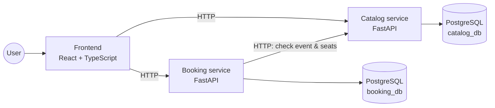

# BookMe

> Find local experiences and secure your spot in seconds.

## Business purpose

BookMe helps people **find local experiences and secure their spot in seconds**, and helps small organizers **fill their events without overselling**.

- **Attendees** discover concerts, workshops, classes, meetups and more nearby, and book a spot in a couple of clicks.
- **Organizers** publish events, set the capacity and see who's coming, with no spreadsheets or DMs.
- **Every spot is sold only once**, even when many people book at the same moment.

Full details (problem, users, business model, booking rules, scope): [docs/BUSINESS.md](docs/BUSINESS.md)

## About

**BookMe** is an event booking platform built as a hands-on learning project: a Python microservices backend with a React frontend.

Users can browse upcoming events, see how many seats are left, and book a seat. The core engineering challenge is **concurrency**: when two people try to book the last seat at the same moment, exactly one of them must win.

### Features (v1)

- Browse events with venue, date and available seats
- Create, update and delete events (catalog management)
- Book a seat for an event
- Guaranteed no double-booking, even under concurrent requests

## Architecture



| Component | Responsibility |
| --- | --- |
| **catalog** | Owns events: name, venue, date, seat capacity. CRUD API. |
| **booking** | Owns bookings. Asks catalog whether an event exists and has seats, then reserves one safely. |
| **frontend** | Web UI to list events and book seats. |

**Rule:** each service owns its own database. Services never read each other's tables; they communicate only over HTTP. Locally, both databases (`catalog_db` and `booking_db`) run in a single PostgreSQL container, but each service connects only to its own.

## Tech stack

| Area | Technology |
| --- | --- |
| Backend | Python 3.13, FastAPI, Pydantic v2 |
| Database | PostgreSQL, SQLAlchemy 2, Alembic (migrations) |
| Frontend | React, TypeScript, Vite, TanStack Query |
| Testing | pytest, httpx (backend) · Vitest, React Testing Library (frontend) |
| Tooling | uv (packages), Ruff (lint + format) |
| Infrastructure | Docker, Docker Compose |

## Project structure

```text
BookM\e/
├── services/
│   ├── catalog/            # events service
│   │   ├── app/                # the service code (import app...)
│   │   │   ├── __init__.py
│   │   │   ├── main.py         # FastAPI app
│   │   │   ├── api/            # HTTP routes
│   │   │   ├── schemas/        # Pydantic models (request/response)
│   │   │   ├── domain/         # business rules
│   │   │   └── db/             # SQLAlchemy models + queries
│   │   ├── tests/
│   │   │   ├── unit/           # domain logic, no database
│   │   │   └── integration/    # API + real PostgreSQL
│   │   ├── Dockerfile
│   │   ├── pyproject.toml      # dependencies + tool config
│   │   └── uv.lock             # exact pinned versions
│   └── booking/                # bookings service (same layout)
├── frontend/                   # React app
├── docker-compose.yml          # runs everything
├── .gitignore
└── README.md
```

Each service is a standalone uv project with its code in an `app/` package (the layout FastAPI's docs use). Services never import each other, so every service can call its package `app`.

## Getting started

### Prerequisites

- [Python 3.13](https://www.python.org/downloads/)
- [uv](https://docs.astral.sh/uv/)
- [Node.js 22+](https://nodejs.org/)
- [Docker](https://www.docker.com/) (runs PostgreSQL from Challenge 4 onward)

### Run locally

_Coming soon. Will be completed in Challenge 9._

```bash
docker compose up
```

### Run tests

_Coming soon._

## Roadmap

- [x] Challenge 0: Repository + README
- [ ] Challenge 1: Setup + Python essentials (uv, `Event` domain class, first tests)
- [ ] Challenge 2: First endpoint: `GET /events` in the catalog service
- [ ] Challenge 3: Full CRUD + validation + tests
- [ ] Challenge 4: Persist events in PostgreSQL (Docker Compose + SQLAlchemy + Alembic)
- [ ] Challenge 5: Booking service talks to catalog over HTTP
- [ ] Challenge 6: Prevent double-booking under concurrent requests
- [ ] Challenge 7: Frontend: list events
- [ ] Challenge 8: Frontend: book a seat
- [ ] Challenge 9: Dockerize everything with Docker Compose

### Bonus track

- [ ] Identity service (sign up, login, JWT)
- [ ] Payments (mock) + notifications via RabbitMQ
- [ ] Redis seat holds that expire
- [ ] Traefik API gateway
- [ ] Playwright end-to-end tests
- [ ] CI with GitHub Actions
